   <div align="center">
     
   </div>

## $ cat about.js

```js
const sayeed = {
  name: "Sayeed Mahmud",
  role: "Full Stack Developer (Learning)",
  location: "Bangladesh",
  status: "Student, building real projects",

  comfortableWith: ["JavaScript", "TypeScript", "React", "Next.js"],
  learningNow: ["Node.js", "Express.js", "MongoDB", "Better Auth"],

  openTo: ["Freelance projects", "Open-source collaboration"],
  contact: "sayeedmahmud343@gmail.com",
};
```
## $ ls skills/

**Frontend** `// comfortable`<br>


**Backend** `// learning`<br>


**Database** `// learning`<br>


**Tools** `// daily use`<br>


## $ ls services/

<table>
  <tr>
    <td width="50%" valign="top">
      <h3>Landing pages & business websites</h3>
      <p>Clean, responsive sites that present your business clearly on any screen.</p>
      <sub>HTML · CSS · Tailwind CSS · Next.js</sub>
    </td>
    <td width="50%" valign="top">
      <h3>React / Next.js web apps</h3>
      <p>Interactive web apps with reusable components and typed, maintainable code.</p>
      <sub>React · Next.js · TypeScript</sub>
    </td>
  </tr>
  <tr>
    <td width="50%" valign="top">
      <h3>REST APIs</h3>
      <p>Backend APIs to store and serve your data.</p>
      <sub>Node.js · Express · MongoDB</sub>
    </td>
    <td width="50%" valign="top">
      <h3>Login & authentication</h3>
      <p>Sign-up and sign-in for your app.</p>
      <sub>Better Auth · Node.js · MongoDB</sub>
    </td>
  </tr>
</table>

> Have something else in mind? [Email me](mailto:sayeedmahmud343@gmail.com?subject=Project%20Inquiry) and let's talk.


## $ ls projects/

<table>
  <tr>
    <td width="33%" valign="top">
      <h3>Bazar Dhor</h3>
      <p>ONE_LINE_DESCRIPTION</p>
      
      
      <br /><br />
      <a href="LIVE_LINK"></a>
      <a href="REPO_LINK"></a>
    </td>
    <td width="33%" valign="top">
      <h3>Country Explore</h3>
      <p>Explore countries and see their key details in one place.</p>
      
      
      <br /><br />
      <a href="LIVE_LINK"></a>
      <a href="https://github.com/sayeedmahmuddevs/Country-Explore-App"></a>
    </td>
    <td width="33%" valign="top">
      <h3>Fit-Log</h3>
      <p>Log and track your fitness activity.</p>
      
      
      <br /><br />
      <a href="LIVE_LINK"></a>
      <a href="https://github.com/sayeedmahmuddevs/Fit-Log"></a>
    </td>
  </tr>
</table>

## $ gh stats --me

<p align="center">
  
  
</p>

<p align="center">
  
</p>


## $ snake --eat contributions

<picture>
  <source media="(prefers-color-scheme: dark)" srcset="https://raw.githubusercontent.com/sayeedmahmuddevs/sayeedmahmuddevs/output/github-snake-dark.svg" />
  <source media="(prefers-color-scheme: light)" srcset="https://raw.githubusercontent.com/sayeedmahmuddevs/sayeedmahmuddevs/output/github-snake.svg" />
  
</picture>

## $ ./contact.sh

**Got a project in mind? Let's talk.** I'm open to freelance work and happy to discuss websites, web apps, and APIs.

<p>
  <a href="mailto:sayeedmahmud343@gmail.com?subject=Project%20Inquiry"></a>
  <a href="https://sayeeddevs.netlify.app"></a>
  <a href="https://www.linkedin.com/in/sayeed-mahmud-devs"></a>
  <a href="https://www.facebook.com/sayeed.mahmud.298421"></a>
  <a href="https://www.instagram.com/sayeed.lam"></a>
</p>


## 🏆 GitHub Trophies


---
[](https://visitcount.itsvg.in)

<!-- Proudly created with GPRM ( https://gprm.itsvg.in ) -->
